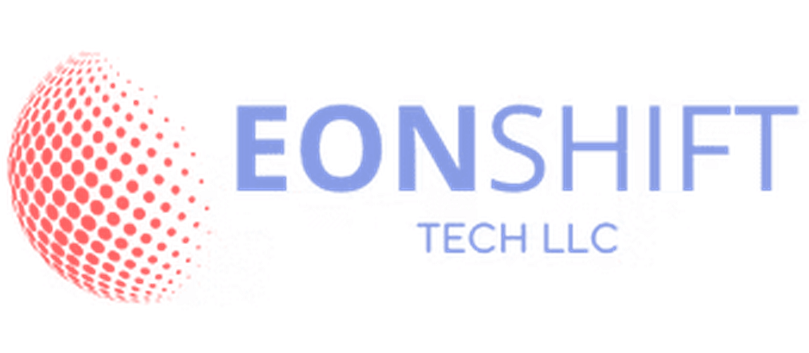

  <a href="https://eonshift.net">
    <picture>
      <source media="(prefers-color-scheme: dark)" srcset="assets/logo-dark.png">
      <source media="(prefers-color-scheme: light)" srcset="assets/logo-light.png">
      
    </picture>
  </a>

<h1 align="center">EonShift Tech LLC</h1>

<b>Managed IT, Cybersecurity & AI for small and midsize businesses.</b>

EonShift keeps your technology running and secure, from help desk and cybersecurity to cloud, networks and AI, so your team can focus on growing the business.

Website: [eonshift.net](https://eonshift.net) · Email: [sales@eonshift.net](mailto:sales@eonshift.net)

---

## About

EonShift Tech LLC is a managed service provider (MSP) for small and midsize businesses. We have been delivering IT projects for more than 10 years, with over 300 projects completed across more than 60 technologies.

Our mission is simple: make technology one less thing you have to worry about.

| | |
|---|---|
| Projects delivered | 300+ |
| Years of experience | 10+ |
| Technologies | 60+ |
| Client retention | ~70% year over year |

## How we work

- **A real team, not a ticket queue.** Every engagement has a dedicated project manager and certified engineers.
- **Security built in, not bolted on.** Security is part of the design from day one.
- **Part of your team.** We work alongside you rather than as a distant vendor.
- **Creative, results-driven, tech-enabled, validated by data.** The four pillars behind our methodology.

## Services

### Managed Services
Ongoing support or one-time consulting, from system audits to IT strategy.

- IT infrastructure design and implementation: servers, storage, networking, virtualization
- Cloud migration and strategy (AWS, Azure, hybrid)
- Project management and agile delivery by certified project managers
- Technology consulting and custom solutions

### Cloud Infrastructure
Public, private and hybrid cloud that is scalable, secure and cost-efficient.

- Cloud architecture design
- Cloud migration services
- Cloud security and compliance: encryption, identity management, compliance monitoring (HIPAA, SOC 2, GDPR)
- Backup and disaster recovery: automated cloud backups and real-time DR

### Network Implementation
Reliable, scalable and secure networks for modern business, delivered in four steps: discover, design and deploy, install and test, project delivery.

- Network architecture consulting
- Wired and wireless network setup (LAN, WAN, Wi-Fi, hybrid)
- Network security integration: firewalls, intrusion prevention, VPNs, monitoring
- Cloud and hybrid networking with AWS, Azure and Google Cloud
- Ongoing monitoring and maintenance with 24/7 support

### Security Systems
End-to-end protection for your people, property and data, combining physical surveillance with network security.

- CCTV and surveillance installation with real-time monitoring and cloud-based access
- Access control: biometric, RFID card or keypad, with real-time logging and remote management
- Intrusion detection and alarm systems with instant alerts
- Network security: firewalls, VPNs, endpoint protection and intrusion detection
- Zero-Trust approach: continuous verification, access controls and data leakage prevention

### Virtual Desktops (VDI)
Secure, anywhere access for remote and hybrid teams.

- Cloud-hosted Windows or Linux desktops with automatic updates and scalable resources
- End-to-end encrypted sessions, multi-factor authentication, role-based access and built-in backup
- Centralized management and monitoring from a single dashboard
- BYOD-friendly deployment

### Artificial Intelligence
Intelligent automation and smart insights that integrate with how your business already works.

- AI strategy and consulting: roadmap, use cases and technology selection
- Machine learning and predictive analytics
- Natural language processing: chatbots, voice assistants and language models
- AI-powered automation of repetitive tasks

### Assessments
Technology assessments and IT audits that uncover inefficiencies, security gaps and growth opportunities, ending in a data-backed roadmap.

- Infrastructure assessment
- Security assessment, including penetration testing, compliance audits and threat analysis
- Cloud readiness assessment
- Workforce and end-user assessment

### Technology Resources
Knowledge and tools to help you stay ahead: a knowledge hub with articles and whitepapers, product documentation, training and certification programmes, and webinars and events.

## Industries

Healthcare & Life Sciences · Finance & Insurance · Technology & SaaS · Manufacturing & Logistics · Retail & eCommerce · Education & Government · Legal & Compliance

## Technology partners

Cisco · Cisco Duo · Cato Networks · Leostream · AWS · Microsoft Azure · Google Cloud

## Insights

We publish practical articles on cybersecurity, cloud, virtual desktops, AI in business and IT strategy. Read them at [eonshift.net/blog](https://eonshift.net/blog/).

## Getting started

1. Book a free consultation or IT assessment with our team.
2. We review your environment and goals with your executive or IT leadership.
3. You receive a bespoke, data-backed plan, then we deliver it.

Start at [eonshift.net/contact-us](https://eonshift.net/contact-us/) or email [sales@eonshift.net](mailto:sales@eonshift.net).

## Locations

| Office | Address |
|---|---|
| Headquarters, Naples, Florida | 15275 Collier Blvd, 201-2039, Naples, FL 34119, USA |
| Dublin, Ireland | 51 Bracken Road, Sandyford, Dublin D18 CV48 |
| London, UK | 128 City Road, London EC1V 2NX |

## Contact

- Sales: [sales@eonshift.net](mailto:sales@eonshift.net)
- Phone: +1 (773) 344-2660
- LinkedIn: [linkedin.com/company/eonshift](https://www.linkedin.com/company/eonshift/)
- Instagram: [@eonshiftllc](https://www.instagram.com/eonshiftllc/)
- Facebook: [EonShift Tech LLC](https://www.facebook.com/people/EonShift-Tech-LLC/61582897591500/)

---

© EonShift Tech LLC. All rights reserved.
